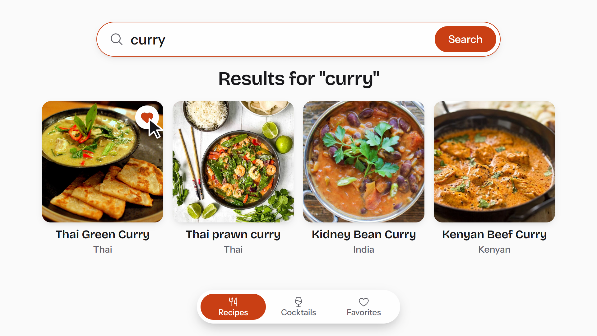

# Recipe Finder 🍳🍹

[](https://nextjs.org/)
[](https://www.typescriptlang.org/)
[](./LICENSE)

A modern, comprehensive Recipe & Cocktail Finder built with Next.js and TypeScript. Discover recipes and cocktails from around the world, powered by 3 completely public APIs (no API keys required!). Search, filter, and explore thousands of recipes and drinks with advanced features and smart filtering.

**🚀 Production-ready | 📱 Mobile-optimized | ⚡ Performance-focused | 🌐 Network-efficient**

## Demo video

[](promo-video/recipe-finder-promo-33s.mp4)

[Watch the promo video (MP4, 33 seconds)](promo-video/recipe-finder-promo-33s.mp4)

## Features

- 🔍 **Advanced Search**: Multi-ingredient search with autocomplete suggestions across 3 public APIs
- 🍹 **Recipes & Cocktails**: Search for both food recipes and cocktails in one place
- 🎨 **Dark/Light Theme**: Beautiful dark theme with orange accents and light theme support
- 📱 **Responsive Design**: Works perfectly on all devices
- 🎥 **Video Support**: YouTube video integration for recipe tutorials
- ⏱️ **Cook Mode**: Fullscreen cooking mode with step-by-step instructions and timers
- ❤️ **Favorites**: Save your favorite recipes and cocktails locally
- 🔍 **Smart Filtering**: Filter by type (recipes/cocktails), cuisine, cook time, diet
- 🌍 **Multi-API Search**: Aggregates results from 3 public recipe APIs (no API keys needed!)
- 🔒 **Admin Panel**: Submit new recipes (protected by token)
- ♿ **Accessible**: Fully keyboard accessible with ARIA labels
- ⚡ **Performance**: Optimized with Next.js Image, React Query caching, and lazy loading
- 📱 **PWA Support**: Installable as a Progressive Web App

## Tech Stack

- **Framework**: Next.js 14 (App Router)
- **Language**: TypeScript
- **Styling**: Tailwind CSS with CSS Variables
- **State Management**: React Query (TanStack Query)
- **Icons**: Lucide React
- **Video Player**: React Player

## API Integrations

The app integrates **3 completely public APIs** (no API keys required!) for comprehensive recipe and cocktail discovery:

1. **TheMealDB** (Primary) - Completely public, no API key required
   - Search by name, filter by area/cuisine
   - YouTube video integration
   - Reference: [TheMealDB API](https://www.themealdb.com/api.php)
   
2. **TheCocktailDB** - Completely public, no API key required
   - Search cocktails and drinks by name
   - Filter by ingredient, category, glass type
   - Random cocktail generator
   - Reference: [TheCocktailDB API](https://www.thecocktaildb.com/api.php)
   
3. **RecipePuppy** (Optional) - Simple ingredient-based search
   - Completely public, no API key required
   - Basic ingredient matching
   - Can be enabled via `NEXT_PUBLIC_USE_RECIPEPUPPY=true` in `.env.local`

## Getting Started

### Prerequisites

- Node.js 18+ and npm/yarn/pnpm

### Installation

1. Clone the repository:
```bash
git clone https://github.com/Papiwrld/recipe-finder.git
cd recipe-finder
```

2. Install dependencies:
```bash
npm install
# or
yarn install
# or
pnpm install
```

3. Create a `.env.local` file in the root directory:
```env
# API Configuration (all free, no API keys needed!)
NEXT_PUBLIC_USE_THEMEALDB=true
NEXT_PUBLIC_USE_THE_COCKTAIL_DB=true
NEXT_PUBLIC_USE_RECIPEPUPPY=false

# Optional: Enable RecipePuppy (completely public, no API key needed)
# NEXT_PUBLIC_USE_RECIPEPUPPY=true

# Admin Token (for recipe submission)
NEXT_PUBLIC_ADMIN_TOKEN=your_admin_token_here
```

4. Run the development server:
```bash
npm run dev
# or
yarn dev
# or
pnpm dev
```

5. Open [http://localhost:3000](http://localhost:3000) in your browser.

## Project Structure

```
Recipe Finder/
├── app/
│   ├── admin/              # Admin panel for recipe submission
│   ├── api/                # API routes (proxies)
│   ├── cocktails/          # Cocktails discovery page
│   ├── favorites/          # Favorites page
│   ├── recipe/             # Recipe detail pages
│   ├── globals.css         # Global styles with theme variables
│   ├── layout.tsx           # Root layout
│   ├── page.tsx            # Home page
│   ├── providers.tsx       # React Query provider
│   └── manifest.ts         # PWA manifest
├── components/             # React components
│   ├── CookMode.tsx       # Fullscreen cooking mode
│   ├── FilterBar.tsx      # Recipe filters
│   ├── Footer.tsx         # Footer with credits
│   ├── Hero.tsx           # Hero section with search
│   ├── RecipeCard.tsx     # Individual recipe card
│   ├── RecipeGrid.tsx     # Grid of recipe cards
│   ├── SearchBar.tsx      # Search with ingredient chips
│   ├── ThemeProvider.tsx  # Theme initialization
│   ├── ThemeToggle.tsx    # Theme switcher
│   └── VideoModal.tsx     # YouTube video modal
├── lib/
│   ├── api/
│   │   └── recipe-api.ts   # API integration layer
│   ├── utils/
│   │   ├── favorites.ts    # Favorites management
│   │   ├── pantry.ts      # Pantry matching utilities
│   │   └── theme.ts       # Theme management
│   └── api-config.ts      # API configuration
├── types/
│   └── recipe.ts          # TypeScript types
└── public/                # Static assets
```

## Recipe Discovery

The app fetches recipes from around the world using public APIs:

- **TheMealDB**: Searches for dishes by name and area
- **Area filtering**: Finds recipes by geographical area
- **Smart search**: Automatically searches and aggregates results from multiple sources

All recipes are fetched dynamically from APIs - no hardcoded data!

## API Configuration

All APIs are **100% free** - no API keys required! Control which APIs to use via environment variables:

- `NEXT_PUBLIC_USE_THEMEALDB=true` - Enable TheMealDB (default: true)
- `NEXT_PUBLIC_USE_THE_COCKTAIL_DB=true` - Enable TheCocktailDB (default: true)
- `NEXT_PUBLIC_USE_RECIPEPUPPY=false` - Enable RecipePuppy as fallback (default: false)

No setup required - all APIs work out of the box!

## Admin Panel

Access the admin panel at `/admin` to submit new recipes. 

1. Enter the admin token (set in `.env.local` as `NEXT_PUBLIC_ADMIN_TOKEN`)
2. Fill out the recipe form
3. Submit to save locally (recipes are stored in localStorage)

**Note**: In production, you should implement a proper backend or serverless function to store recipes.

## Building for Production

```bash
npm run build
npm start
```

## Deployment

See [DEPLOYMENT.md](./DEPLOYMENT.md) for detailed deployment instructions.

Quick deploy to Vercel:
[](https://vercel.com/new/clone?repository-url=https://github.com/Papiwrld/recipe-finder)

## Performance

This app is optimized for:
- ⚡ **Fast Loading**: Image optimization, code splitting, lazy loading
- 📱 **Mobile First**: Responsive design for all devices
- 🌐 **Network Efficient**: Caching, compression, minimal bundle size
- ♿ **Accessible**: WCAG compliant, keyboard navigation
- 🔍 **SEO Optimized**: Meta tags, structured data, Open Graph

## Browser Support

- Chrome (latest)
- Firefox (latest)
- Safari (latest)
- Edge (latest)
- Mobile browsers (iOS Safari, Chrome Mobile)

## Contributing

Contributions are welcome! Please see [CONTRIBUTING.md](./CONTRIBUTING.md) for guidelines.

## Credits

Built by **Awagah Eugene Kwesi**

- Email: kwesieugene77@gmail.com
- GitHub: [@Papiwrld](https://github.com/Papiwrld)
- X (Twitter): [@papiwrld_](https://x.com/papiwrld_?s=21)
- LinkedIn: [Eugene Awagah](https://www.linkedin.com/in/eugene-awagah-86068a341)

## License

MIT License - feel free to use this project for your own purposes.

See [LICENSE](./LICENSE) for details.

---

**Built with ❤️ by [Awagah Eugene Kwesi](https://github.com/Papiwrld)**

**Enjoy cooking! 🍳✨**
